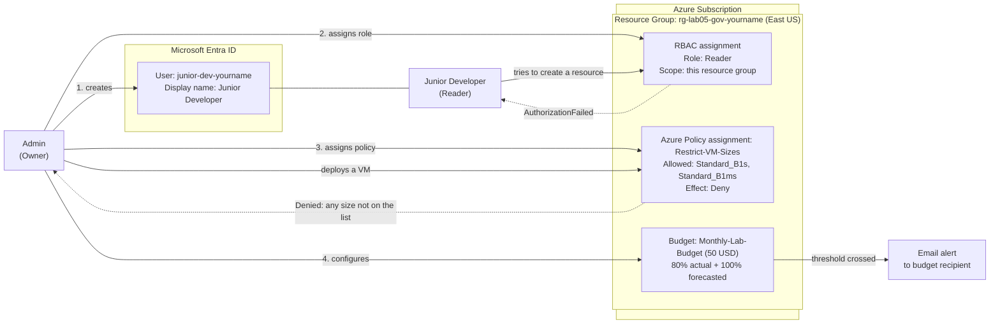
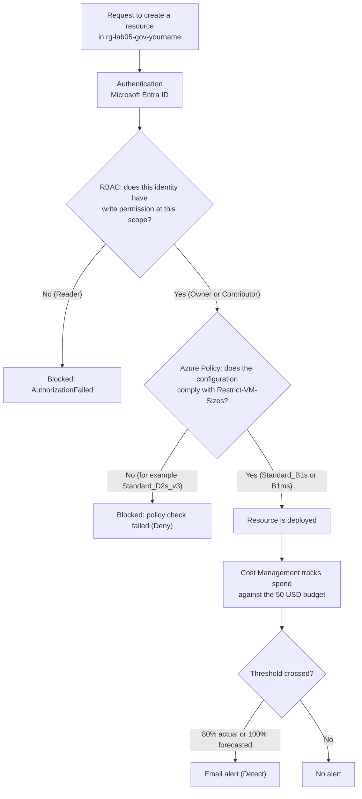

# Implementing Governance and Security Hardening


**Estimated time:** 60 to 75 minutes
**Difficulty:** Beginner
**Framework:** NIST Cybersecurity Framework (CSF)

## [🎬 Watch Me Build This Lab!](https://streamable.com/2639vb)


---

## Table of Contents

1. [Overview](#1-overview)
2. [Architecture](#2-architecture)
3. [Key Concepts](#3-key-concepts)
4. [NIST CSF Mapping](#4-nist-csf-mapping)
5. [Prerequisites](#5-prerequisites)
6. [Lab Variables](#6-lab-variables)
7. [Step-by-Step Instructions](#7-step-by-step-instructions)
8. [Validation](#8-validation)
9. [Security Considerations](#9-security-considerations)
10. [Troubleshooting](#10-troubleshooting)
11. [Clean Up](#11-clean-up)
12. [Key Takeaways](#12-key-takeaways)

---

## 1. Overview

Building cloud resources is only half the job. The other half is making sure the **right people** have the **right access**, only **approved configurations** get deployed, and someone **finds out quickly** when spend drifts. That discipline is **cloud governance**.

This lab implements three governance controls on a single resource group:

| Question | Control | Tool |
|----------|---------|------|
| **Who** is allowed to do what? | Read-only access for a junior user | Azure RBAC (Reader role) |
| **What** configurations are allowed? | Block every VM size except two small, cheap ones | Azure Policy (Deny effect) |
| **How much** can we spend, and who is told? | Monthly budget with email alerts | Azure Cost Management |

Each control is then **tested** to prove it works, and mapped to the **NIST Cybersecurity Framework**.

**What this lab demonstrates**

- Creating an identity in Microsoft Entra ID and applying least privilege
- Scoping a role assignment to one resource group
- Verifying a control by attempting a prohibited action as the restricted user
- Assigning a built-in Azure Policy and testing it in both directions (blocked and allowed)
- Configuring actual and forecasted budget alerts
- Explaining how each control supports a NIST CSF function

---

## 2. Architecture

### 2.1 Governance Controls and Scope



### 2.2 How a Deployment Request Is Evaluated



### 2.3 Layered Defense

| Layer | Control | Stops this kind of problem |
|-------|---------|----------------------------|
| **Who** | RBAC (Reader) | A user with view-only access deleting or changing resources |
| **What** | Azure Policy (Deny) | An accidental or unapproved expensive VM size, blocked before any cost is incurred |
| **How much** | Budget alerts | Spend creeping up from forgotten resources, runaway jobs, or abuse of a compromised account |

---

## 3. Key Concepts

### Azure RBAC

Role-Based Access Control decides **who can do what**. Permissions are bundled into **roles**, and a role is assigned to a person at a **scope** (subscription, resource group, or resource).

| Role | What it can do |
|------|----------------|
| **Owner** | Everything, including granting access to others |
| **Contributor** | Create, change, and delete resources, but cannot grant access |
| **Reader** | View resources only. Cannot create, change, or delete anything |

This lab assigns **Reader** scoped to **one resource group**, which is least privilege in practice: the user can see that group and nothing else. New identities start with **no permissions** (deny by default).

### Azure Policy

RBAC controls *who* can act. Azure Policy controls *what configurations are allowed*, regardless of who is acting.

| Term | Meaning |
|------|---------|
| **Policy definition** | The rule (for example, "only allow these VM sizes"). This lab uses a built-in Microsoft definition |
| **Policy assignment** | Applying a definition to a scope. A definition does nothing until assigned |
| **Scope** | Where it applies. Here: one resource group |
| **Effect** | What happens on a violation. **Deny** blocks the deployment. **Audit** only logs it |
| **Evaluation** | Checked at deployment time. A new assignment can take **10 to 30 minutes** to propagate |

### Cost Management Budgets

| Term | Meaning |
|------|---------|
| **Budget** | A spending threshold for a scope over a period |
| **Actual alert** | Fires after spend has crossed a percentage of the budget |
| **Forecasted alert** | Fires when the current spending trend is projected to cross the budget |
| **Action group** | Optional. Lets an alert do more than email (SMS, webhook, automation) |

> **Important:** a budget is a **smoke detector, not a sprinkler**. It does **not** stop spending, shut anything down, or block new deployments. It only notifies.

---

## 4. NIST CSF Mapping

| NIST function | Where it appears in this lab |
|---------------|------------------------------|
| **Identify** | Creating the user in Microsoft Entra ID and knowing who they are before granting any access |
| **Protect** | The Reader role (RBAC) and the VM size policy (Azure Policy) limit what any person or misconfiguration can do |
| **Detect** | The budget alert surfaces abnormal spend, which can signal misconfiguration or a compromised account |
| **Respond** | Receiving the alert and investigating the cause is the start of a response process |
| **Recover** | Cleaning up the test user and resource group returns the environment to a known good state |

> **Note:** NIST CSF 2.0 (released 2024) added a sixth function, **Govern**, covering organizational context, roles and responsibilities, and policy. The controls in this lab (assigned roles, enforced policy, spending oversight) are governance activities in the same spirit. This lab uses the original five-function layout for clarity.

---

## 5. Prerequisites

- [ ] Active Azure subscription
- [ ] An account that can create resources, assign roles, and assign policies at the resource group (Owner works)
- [ ] Permission to create users in Microsoft Entra ID (for example, the User Administrator role)
- [ ] Permission to create budgets (Owner or Cost Management Contributor)
- [ ] An Incognito or Private browser window, to sign in as the test user without signing out of your admin account
- [ ] About 15 to 30 minutes of patience for Azure Policy to propagate (normal, not a bug)

---

## 6. Lab Variables

| Item | Value |
|------|-------|
| Resource group | `rg-lab05-gov-[yourname]` |
| Region | `East US` |
| Test user (UPN) | `junior-dev-[yourname]@[yourtenant].onmicrosoft.com` |
| Test user display name | `Junior Developer` |
| Role | `Reader` (scoped to the resource group) |
| Policy definition | Allowed virtual machine size SKUs (built in) |
| Policy assignment name | `Restrict-VM-Sizes` |
| Allowed sizes | `Standard_B1s`, `Standard_B1ms` |
| Budget name | `Monthly-Lab-Budget` |
| Budget amount | `$50` per billing month |

> Use your first name in lowercase with no spaces in place of `[yourname]`.

---

## 7. Step-by-Step Instructions

### Phase 1: Create the Resource Group

The resource group is the **scope** for every control in this lab, so nothing else in the subscription is affected.

1. Sign in to the [Azure Portal](https://portal.azure.com) with your admin account.
2. Search for **Resource groups** and click **+ Create**.
3. **Subscription:** your subscription
4. **Resource group:** `rg-lab05-gov-[yourname]`
5. **Region:** `East US`
6. Click **Review + create**, then **Create**.

**Expected result:** the resource group appears in your list.

### Phase 2: RBAC. Create a User and Restrict Their Access

#### Step 1: Create the user in Microsoft Entra ID (Identify)

1. Search for **Microsoft Entra ID** and open it.
2. Click **Users**, then **+ New user > Create new user**.
3. **User principal name:** `junior-dev-[yourname]` (the tenant domain is appended automatically)
4. **Display name:** `Junior Developer`
5. **Password:** uncheck auto-generate and set a **strong, unique** password you will use in Phase 3.
6. Click **Review + create**, then **Create**.

**Expected result:** the user appears in the Users list.

#### Step 2: Assign the Reader role at the resource group (Protect)

A new user has no access until you grant it.

1. Open `rg-lab05-gov-[yourname]`.
2. Click **Access control (IAM)**.
3. Click **+ Add > Add role assignment**.
4. **Role** tab: select **Reader**, then **Next**.
5. **Members** tab: **+ Select members**, choose **Junior Developer**, then **Select**.
6. Click **Review + assign** (twice) to confirm.

**Expected result:** under **Role assignments**, Junior Developer is listed with the **Reader** role at this resource group scope.

### Phase 3: Verify Access (the "Permission Denied" Test)

1. Open a new **Incognito / Private** window and go to [portal.azure.com](https://portal.azure.com).
2. Sign in as `junior-dev-[yourname]@[yourtenant].onmicrosoft.com`. Complete any MFA setup or welcome prompts.
3. Open **Resource groups**. You should see **only** `rg-lab05-gov-[yourname]`.
4. Open that resource group and click **+ Create**.
5. Search for **Storage account**, click **Create**, enter any name, and click **Review + create**.

**Expected result:** an error such as *"You do not have permission to perform this action"* or **AuthorizationFailed**. This is the control working as designed.

6. Close the Incognito window and return to your admin session.

### Phase 4: Azure Policy. Prevent Expensive Configurations (Protect)

Policy applies to everyone, including the Owner account. The scenario it prevents: an engineer picks a 32-core `Standard_D32s_v3` when a 2-core size was intended.

#### Step 1: Create the policy assignment

1. Search for **Policy** and open it.
2. Under **Authoring**, click **Assignments**, then **Assign policy**.
3. **Basics** tab:
   - **Scope:** select your subscription and then the resource group `rg-lab05-gov-[yourname]`
   - **Policy definition:** search for **Allowed virtual machine size SKUs** and select it
   - **Assignment name:** `Restrict-VM-Sizes`
4. Click **Next** to open the **Parameters** tab:
   - Uncheck **Only show parameters that need input or review**
   - **Allowed Size SKUs:** select `Standard_B1s` and `Standard_B1ms`
5. Click **Review + create**, then **Create**.

**Expected result:** `Restrict-VM-Sizes` appears under Assignments with your resource group as the scope.

> **Wait 10 to 30 minutes** before testing. Policy assignments take time to propagate.

#### Step 2: Understand what you built

| Component | In plain English |
|-----------|------------------|
| Policy definition | The pre-built rule: only approved VM sizes are allowed |
| Policy assignment | Turns the rule on for this resource group |
| Allowed SKUs parameter | The approved list. B1s and B1ms are cheap, suitable for a lab |

### Phase 5: Test the Policy (Both Directions)

1. Open `rg-lab05-gov-[yourname]` and click **+ Create**.
2. Search for **Virtual machine** and click **Create**.
3. **Basics:** name it `vm-policy-test` and choose **Ubuntu Server** as the image.
4. **Size:** click **See all sizes** and select **Standard_D2s_v3** (not on the allowed list).
5. Click **Review + create**.

**Expected result (blocked):** a red **Validation failed** banner. Expand it to see the policy check failure naming `Restrict-VM-Sizes`.

6. Now change the size to **Standard_B1s** and click **Review + create** again.

**Expected result (allowed):** validation **passes**. You do not need to complete the deployment.

> Testing both a violation and a compliant configuration proves the policy blocks only what it should.

### Phase 6: Cost Management. Create a Budget and Alerts (Detect)

#### Step 1: Create the budget

1. Open `rg-lab05-gov-[yourname]` and find **Budgets** under **Cost Management** (or search for "Budgets" in the left menu).
2. Click **+ Add**.
3. **Name:** `Monthly-Lab-Budget`
4. **Reset period:** Billing month
5. **Expiration date:** one year from today
6. **Budget amount:** `$50`
7. Click **Next**.

#### Step 2: Configure alert conditions

| Alert | Type | % of budget | Meaning |
|-------|------|-------------|---------|
| 1 | **Actual** | 80 | Alert after $40 has actually been spent |
| 2 | **Forecasted** | 100 | Alert when the spending trend is projected to exceed $50 |

#### Step 3: Set the recipient

1. **Alert recipients:** enter your email address.
2. **Language:** English.
3. Click **Create**.

**Expected result:** `Monthly-Lab-Budget` is listed with a $50 limit and both alert conditions.

### What the Budget Does and Does Not Do

| It does | It does NOT |
|---------|-------------|
| Watch spend against $50 for this resource group | Stop, pause, or delete any resource |
| Email you at 80% actual spend | Block new deployments |
| Email you when spend is forecast to exceed $50 | Reduce the size or count of resources |
| Reset on the first of each month | Take any action without a person (unless paired with an action group) |

---

## 8. Validation

### Verification Checklist

| Check | What to confirm |
|-------|-----------------|
| User exists | Entra ID > Users shows `junior-dev-[yourname]` |
| Reader role assigned | Resource group > Access control (IAM) > Role assignments lists Junior Developer as **Reader** |
| Permission denied | The Incognito test returned **AuthorizationFailed** when creating a storage account |
| Policy assigned | Policy > Assignments shows `Restrict-VM-Sizes` scoped to the resource group |
| Policy blocks violations | `Standard_D2s_v3` fails validation naming `Restrict-VM-Sizes` |
| Policy allows approved sizes | `Standard_B1s` passes validation |
| Budget created | Resource group > Budgets shows `Monthly-Lab-Budget` at $50 |
| Both alerts set | 80% Actual and 100% Forecasted are configured |
| Email recipient set | Your email appears under the alert recipients |

> **Honest scope note:** this lab verifies that the budget and alerts are **configured correctly**. With no workloads running, spend stays near zero, so the alerts will not actually fire during the lab.

### Evidence

Add screenshots to a `docs/images/` folder and update the paths below.

| Step | Screenshot |
|------|-----------|
| Resource group created | `` |
| Junior Developer user in Entra ID | `` |
| Reader role assignment | `` |
| AuthorizationFailed as Junior Developer | `` |
| Policy assignment | `` |
| D2s_v3 blocked by policy | `` |
| B1s passes validation | `` |
| Budget and alert conditions | `` |

---

## 9. Security Considerations

| Topic | What to know |
|-------|--------------|
| **Least privilege** | Grant the minimum access needed. Reader at resource group scope limits the blast radius of mistakes and of a compromised account. |
| **Reader is not "no risk"** | Reader can view configuration and metadata for everything in scope. It cannot change resources, but sensitive settings can still be visible, so scope it narrowly. |
| **Scope matters** | The most common RBAC mistake is assigning a role at too broad a scope. Confirm where an assignment actually lives. |
| **Groups over individuals** | In real environments, assign roles to **groups** so access follows job function and is easy to review and revoke. |
| **Policy applies regardless of role** | A Deny policy blocks deployments even by an Owner. However, anyone with permission to manage policy assignments can change or remove them, so protect those permissions and use exemptions deliberately. |
| **Audit before Deny** | In production, introduce a new policy in **Audit** mode first to see what would break, then move to **Deny**. |
| **Use a management group for scale** | Policies assigned at a management group or subscription cover every resource group beneath them. This lab uses one resource group to stay contained. |
| **Cost anomalies are security signals** | A sudden spend spike can mean misconfiguration, a forgotten resource, or a compromised account running unauthorized workloads. |
| **Alerts are not instant** | Cost data is not real-time, so budget alerts can lag. Do not treat them as the only detection control. |
| **Automate the response** | Pair budgets with an **action group** (notification lists, webhooks, automation) so an alert leads to action. |
| **MFA and identity hygiene** | Expect MFA registration on first sign-in and use a strong, unique password for test users. Delete test identities when finished. Unused accounts expand your attack surface. |

---

## 10. Troubleshooting

| Issue | Likely cause | Fix |
|-------|--------------|-----|
| **Junior Developer can still create resources** | Role was assigned at the wrong scope (for example, the subscription) | Check the resource group's **Access control (IAM) > Role assignments**. If Reader is not listed there, assign it at the resource group. |
| **Junior Developer cannot see the resource group** | Role not assigned yet, or still propagating | Confirm the assignment, wait a few minutes, then sign out and back in. |
| **Policy does not block `Standard_D2s_v3`** | Assignment has not finished propagating | Wait 15 minutes and retry. If still not blocked after 30 minutes, confirm `Restrict-VM-Sizes` is listed with the correct scope. |
| **Policy definition not found** | Search term slightly off | Search for `virtual machine size` without quotes and choose the allowed sizes / SKUs definition. |
| **Cannot find Budgets in the resource group menu** | Not shown for all subscription types | Go to **Cost Management + Billing** from the main search and open **Budgets** there. |
| **Budget creation fails with a permissions error** | Missing Cost Management write permission | Check **Subscription > Access control (IAM)** for Owner or Cost Management Contributor, or request it from your administrator. |
| **Cannot create the user** | Missing Entra ID permission | Ask for a role that can create users (for example, User Administrator). |
| **Incognito sign-in asks to set up an authenticator** | MFA registration on first sign-in | Complete the setup. This is expected and is a Protect control in action. |
| **Budget alert never arrives** | No meaningful spend in the lab | Expected. The lab validates configuration, not an actual threshold breach. |

---

## 11. Clean Up

Return the environment to a known good state (the **Recover** mindset).

1. **Delete the resource group:** `rg-lab05-gov-[yourname]` > **Overview > Delete resource group**, type the name to confirm. This also removes the policy assignment and budget scoped to it.
2. **Delete the test user:** **Microsoft Entra ID > Users** > `junior-dev-[yourname]` > **Delete**.
3. **Verify:**
   - `rg-lab05-gov-[yourname]` no longer appears under **Resource groups**
   - `junior-dev-[yourname]` no longer appears under **Users**

---

## 12. Key Takeaways

- **RBAC controls who can act. Policy controls what is allowed. Budgets control awareness of spend.** Together they form layered defense.
- Least privilege and scope are the heart of RBAC. A role is only as safe as the scope it is assigned at.
- A control you have not tested is a control you cannot trust. Test both the blocked and the allowed path.
- A budget is a notification tool, not an enforcement tool. Automation turns an alert into a response.
- Cost data is security data. Unexpected spend is an early warning worth watching.
- Governance maps cleanly onto the NIST CSF, which makes it easy to explain what each control is for.

---

## Repository Structure

```text
.
├── README.md
└── docs/
    └── images/
```
